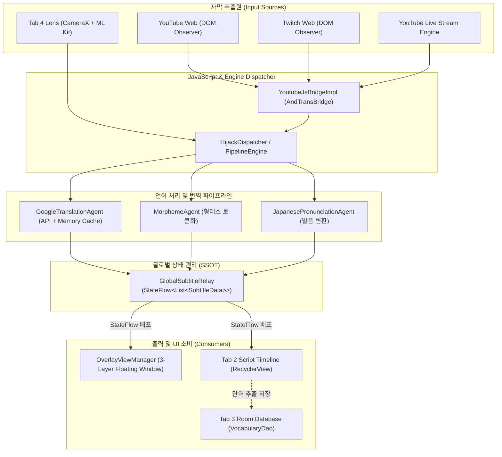

# 🌐 AndTranslate (Viitor Project)

<div align="center">


<p align="center">
  <b>실시간 스트리밍 비디오 자막 하이재킹 & AI 멀티모달 언어 학습 솔루션</b><br>
  YouTube 및 Twitch 비디오의 실시간 DOM 자막을 인터셉트하여 3-Layer(원문·번역·발음) 플로팅 오버레이와 연동하고,<br>
  CameraX 기반 ML Kit OCR 및 단어장 필기 캔버스를 통합 제공하는 현대적인 Android 애플리케이션입니다.
</p>

</div>

---

## 📑 목차 (Table of Contents)
- [✨ 핵심 기능 (Key Features)](#-핵심-기능-key-features)
- [🏛️ 아키텍처 및 데이터 흐름 (Architecture & Data Flow)](#️-아키텍처-및-데이터-흐름-architecture--data-flow)
- [🛠️ 기술 스택 (Tech Stack)](#️-기술-스택-tech-stack)
- [📂 프로젝트 구조 (Project Structure)](#-프로젝트-구조-project-structure)
- [🚀 시작하기 (Getting Started)](#-시작하기-getting-started)

---

## ✨ 핵심 기능 (Key Features)

### 1. 🪟 3-Layer 플로팅 오버레이 (Floating Subtitle Overlay)
화면 최상단(`WindowManager.LayoutParams.TYPE_APPLICATION_OVERLAY`)에 상시 표시되는 반응형 자막 대시보드입니다.
- **3단계 계층형 자막 투사:**
  - **L1 (원문):** 일본어/영어 실시간 원문 자막
  - **L2 (번역문):** 최적화된 문맥 번역 (최대 4줄 제한 및 실시간 말줄임 가드)
  - **L3 (발음 보조):** 로마자 및 한국식 발음 음차 (최대 2줄 제한)
- **핀치 투 줌 (Pinch-to-scale):** 멀티터치 제스처를 통한 오버레이 윈도우 크기 실시간 조절
- **알파 슬라이더 (Alpha Control):** 영상 시야 확보를 위한 오버레이 투명도(0~100%) 미세 조정
- **즉시 모드 전환:** 🇯🇵 `JA ➔ KO` (일본어 ➔ 한국어) 및 🇺🇸 `EN ➔ KO` (영어 ➔ 한국어) 실시간 스위칭 지원
- **대시보드 퀵 컨트롤:** H(투명도 슬라이더 토글), T(발음 레이어 토글), 🛠(자막 복구 요청), ⏯(영상 재생/일시정지 토글), ⚙(설정 패널)

---

### 2. 📱 4대 핵심 탭 (Core Tabs)

| 탭 | 명칭 | 기능 설명 | 주요 기술 |
| :---: | :---: | :--- | :--- |
| **Tab 1** | **🌐 Browser** | **웹뷰 스트리밍 하이재킹 & 실시간 번역**<br>YouTube / Twitch 모바일 웹의 자막 요소를 가로채고 인메모리 캐시 기반 구글 번역 파이프라인으로 전달 | `WebView`, DOM `MutationObserver`, `JavascriptInterface`, `GoogleTranslationAgent` |
| **Tab 2** | **📜 Script** | **실시간 스크립트 타임라인 & 타임라인 워프**<br>영상의 전체 대사를 타임라인 리스트로 기록. 형태소 단위 토큰 분절을 제공하며, 특정 대사 클릭 시 영상 구간 점프(Warp) 및 단어장 보관 지원 | `RecyclerView`, `MorphemeAgent`, 타임스탬프 동기화 |
| **Tab 3** | **📚 Words** | **단어 보관함 (Vault) & 한자 제스처 캔버스**<br>학습할 단어, 문맥, 타임스탬프 영속 저장. 직접 손글씨를 그리며 암기할 수 있는 커스텀 필기 캔버스 및 퀴즈 제공 | `Room 2.6` (KSP), `HandwritingCanvasView`, `MaterialCardView` |
| **Tab 4** | **🔍 Lens** | **실시간 카메라 OCR 스캐너**<br>카메라 프리뷰 상의 일본어/외국어 텍스트를 실시간으로 인식하여 즉각적인 번역 오버레이 제공 | `CameraX 1.3.1`, `Google ML Kit (Japanese Text Recognition)` |

---

## 🏛️ 아키텍처 및 데이터 흐름 (Architecture & Data Flow)

AndTranslate는 **Single Source of Truth (SSOT)** 원칙에 따라 `GlobalSubtitleRelay` 싱글톤을 중심으로 데이터 흐름이 단방향으로 전파되도록 설계되었습니다.



---

## 🛠️ 기술 스택 (Tech Stack)

### Architecture & Foundation
- **Kotlin 1.9.22**: 코루틴(`Coroutines`) 및 `StateFlow` 기반 완전 비동기 반응형 파이프라인
- **Android Architecture Components**: `ViewModel`, `Lifecycle`, `ViewBinding`
- **Gradle 8.5 (Kotlin DSL)**: 멀티 모듈 및 빌드 최적화 지원

### Data & Persistence
- **Room Database 2.6.1**: SQLite 객체 매핑 및 로컬 데이터 영속화
- **Google KSP (Kotlin Symbol Processing) 1.9.22-1.0.17**: KAPT 대비 최대 2배 빠른 컴파일 속도로 Room Kotlin 코드 직접 생성

### Computer Vision & ML
- **CameraX 1.3.1** (`camera-core`, `camera-camera2`, `camera-lifecycle`, `camera-view`): 고성능 카메라 하드웨어 제어
- **Google ML Kit Text Recognition Japanese (v16.0.0)**: 온디바이스 일본어 문자 감지 및 고정밀 OCR

### UI / UX System
- **Material Design 3 (MDC 1.11.0)**: 현대적인 카드 및 테마 디자인 (`Theme.AndTranslate`)
- **WindowManager Application Overlay**: 시스템 권한 기반 플로팅 윈도우 및 멀티터치 제스처
- **FlexboxLayout 3.0.0**: 유연한 토큰 태그 레이아웃 구성
- **Custom Canvas View (`HandwritingCanvasView`)**: 저지연 터치 드로잉 렌더링

### Networking & Web Engine
- **Android WebView & DOM Injection**: 모바일 스트리밍 사이트 DOM 실시간 감지
- **Retrofit 2.9.0 & Gson**: 번역 엔드포인트 REST 통신

---

## 📂 프로젝트 구조 (Project Structure)

```text
AndTranslate/
├── apps/
│   └── android/                      # 메인 안드로이드 애플리케이션
│       ├── build.gradle.kts          # 의존성 및 KSP, SDK 설정
│       └── src/main/
│           ├── AndroidManifest.xml   # 권한, 서비스, 테마 선언
│           ├── kotlin/com/viitor/
│           │   ├── data/local/       # Room DB, VocabularyDao, Entity
│           │   ├── hijack/           # YouTube/Twitch DOM 감지 인터셉트 엔진
│           │   ├── pipeline/core/    # GlobalSubtitleRelay(SSOT), Morpheme, Pronunciation
│           │   ├── service/          # SubtitleCaptureService, OverlayViewManager
│           │   ├── ui/
│           │   │   ├── tab1_browser/ # 웹뷰 브라우저 및 TranslationAgent
│           │   │   ├── tab2_script/  # 타임라인 어댑터 및 대사 워프 로직
│           │   │   ├── tab3_words/   # 단어장 보관함 및 필기 캔버스
│           │   │   ├── tab4_lens/    # CameraX & ML Kit OCR 스캐너
│           │   │   └── overlay/      # 사이드 플로팅 컨트롤러
│           │   └── util/             # ResourceBroker, DictActionUtil
│           └── res/                  # Material 3 레이아웃, 컬러, 아이콘 에셋
├── logs/                             # 빌드 산출물 및 디버깅 로그캣 아카이브
└── README.md                         # 프로젝트 개요 및 기술 가이드
```

---

## 🚀 시작하기 (Getting Started)

### 요구사항 (Prerequisites)
- **Android Studio:** Hedgehog (2023.1.1) 이상 권장
- **JDK:** OpenJDK 17
- **Android SDK:** Compile SDK 34 / Min SDK 26 (Android 8.0 Oreo 이상)

### 빌드 및 설치 (Build & Run)

```bash
# 저장소 복제
git clone https://github.com/hdy4567/AndTranslate.git
cd AndTranslate

# 디버그 APK 빌드
./gradlew assembleDebug

# 연결된 안드로이드 기기에 설치
./gradlew installDebug
```

> **필수 권한 안내:**  
> 앱 첫 실행 시 다른 앱 위에 그리기 권한(`SYSTEM_ALERT_WINDOW`)과 카메라 권한(`CAMERA`) 허용이 필요합니다.
